# Dimensional model

> US-10 (KAN-84), T-10.1; final version for US-59 (KAN-326), November 2026. Star schema built by Spark in the **S3
> curated** layer and read by Power BI. The first diagram is the design; **As built** below is what the curated layer and
> `voltiagrid-final.pbix` actually have, and wins where they differ. Lineage of every table: *Lineage of the analytics model*.

## Design choices

- **Star schema:** five fact tables that share the same dimensions (conformed dimensions), so every visual can be filtered by date, customer, meter or transformer.
- **Grain first:** every fact table declares what one row means before listing measures.
- **Deterministic keys** (decided in the US-48 review): `date_key` is the date as `yyyymmdd`, `time_key` the 30-minute slot (0–47), and meter, customer, transformer, circuit and band keep their F4 and F7 codes (`MAC000002`, `CU-MAC000002`, `TR-00001`, `peak`). A fact never needs a lookup to get its keys, a rerun gives the same keys, and the dimensions of US-52 use the same values. The type 2 dimensions add `valid_from` to tell versions apart.
- **History where it matters:** `dim_customer` and `dim_tariff_band` keep versions by effective date (slowly changing dimension type 2), because RN-05 needs the tariff valid on each date and RN-07 needs to know whether the contract changed.
- **Source of truth:** dimensions come from F4 (inventory), F7 (tariff calendar) and F2/F6 (weather); facts come from the clean readings and the results of the business rules.

## Star schema

```mermaid
erDiagram
  DIM_DATE ||--o{ FACT_CONSUMPTION : "date_key"
  DIM_TIME_OF_DAY ||--o{ FACT_CONSUMPTION : "time_key"
  DIM_METER ||--o{ FACT_CONSUMPTION : "meter_key"
  DIM_CUSTOMER ||--o{ FACT_CONSUMPTION : "customer_key"
  DIM_TRANSFORMER ||--o{ FACT_CONSUMPTION : "transformer_key"
  DIM_TARIFF_BAND ||--o{ FACT_CONSUMPTION : "band_key"

  DIM_DATE ||--o{ FACT_TRANSFORMER_LOSS_DAILY : "date_key"
  DIM_TRANSFORMER ||--o{ FACT_TRANSFORMER_LOSS_DAILY : "transformer_key"

  DIM_DATE ||--o{ FACT_LOAD_WEATHER_HOURLY : "date_key"
  DIM_TRANSFORMER ||--o{ FACT_LOAD_WEATHER_HOURLY : "transformer_key"

  DIM_DR_EVENT ||--o{ FACT_DR_PARTICIPATION : "event_key"
  DIM_CUSTOMER ||--o{ FACT_DR_PARTICIPATION : "customer_key"
  DIM_DATE ||--o{ FACT_DR_PARTICIPATION : "date_key"

  DIM_CUSTOMER ||--o{ FACT_BILLING_MONTHLY : "customer_key"
  DIM_METER ||--o{ FACT_BILLING_MONTHLY : "meter_key"
  DIM_MONTH ||--o{ FACT_BILLING_MONTHLY : "month_key"
  DIM_EXCLUSION_REASON ||--o{ FACT_BILLING_MONTHLY : "reason_key"

  FACT_CONSUMPTION {
    decimal energy_kwh
    decimal energy_cost
    int is_estimated
    string estimation_method
  }
  FACT_TRANSFORMER_LOSS_DAILY {
    decimal delivered_kwh
    decimal metered_kwh
    decimal loss_kwh
    decimal loss_pct
    decimal loss_cost
    int is_suspicious
  }
  FACT_LOAD_WEATHER_HOURLY {
    decimal delivered_kwh
    decimal load_pct_capacity
    decimal temperature_c
  }
  FACT_DR_PARTICIPATION {
    decimal baseline_kwh
    decimal actual_kwh
    decimal savings_kwh
    decimal savings_pct
    int incentive_paid
    decimal incentive_amount
  }
  FACT_BILLING_MONTHLY {
    decimal total_kwh
    int total_readings
    int estimated_readings
    decimal estimated_pct
    int is_billable
    int inspection_order
  }
```

## Fact tables

| Fact table | Grain (one row is…) | Measures | Built from | Rules |
|---|---|---|---|---|
| `fact_consumption` | one **meter** in one **30-minute interval** | `energy_kwh`, `energy_cost` (kWh × band price), `is_estimated` (0/1), `estimation_method` (none, interpolation, profile) | Filled readings (clean + estimated, US-34) + F4 + F7 | RN-01, RN-02, RN-03, RN-05 |
| `fact_transformer_loss_daily` | one **transformer** on one **day** | `delivered_kwh`, `metered_kwh`, `loss_kwh`, `loss_pct`, `loss_cost`, `consecutive_days_over_12`, `is_suspicious` (0/1) | F5 + sum of `fact_consumption` | RN-06, RN-07 |
| `fact_load_weather_hourly` | one **transformer** in one **hour** | `delivered_kwh`, `peak_kw`, `load_pct_capacity`, `temperature_c` | F5 + F2/F6 | RN-08 input |
| `fact_dr_participation` | one **customer** in one **demand-response event** | `baseline_kwh`, `actual_kwh`, `savings_kwh`, `savings_pct`, `incentive_paid` (0/1), `incentive_amount` | `dr_settlement` + `dr_events` + F4 (as built) | RN-08, RN-09, RN-10 |
| `fact_billing_monthly` | one **customer** (meter) in one **month** | `total_kwh`, `total_readings`, `estimated_readings`, `estimated_pct`, `is_billable` (0/1), `inspection_order` (0/1) | Aggregate of `fact_consumption` | RN-04 |

## Built in the curated layer

What each fact looks like once its Spark job exists (voltiagrid-data, `docs/data/analytics.md`). Reviewed against this
model before merging; differences are listed.

| Fact | Dataset and job | Keys | Review |
|---|---|---|---|
| `fact_consumption` | `curated/dataset=fact_consumption_interval/date=…`, `jobs.fact_consumption_interval` (US-48) | `date_key`, `time_key`, `meter_id`, `customer_code`, `transformer_code`, `band_name` | Grain and measures as designed. Named `_interval` because `curated/dataset=fact_consumption` already holds the monthly billing aggregate of US-35. Adds `tariff_valid_from` (which F7 period priced the row) and `interval_start`. Built from the filled readings, so estimated intervals are in the fact with `is_estimated = 1`. No orphan keys: meters that F4 does not have are left out and counted (as in the monthly fact of US-35), and the job stops if an interval has no F7 band. |
| `fact_transformer_loss_daily` | `curated/dataset=fact_transformer_loss_daily/date=…`, `jobs.fact_transformer_loss` (US-51) | `date_key`, `transformer_code`, `circuit_code` | Grain and measures as designed, plus `estimated_kwh` and `suspicious_rank`. Built from `transformer_losses` and `suspicious_transformers`, which read F5 and the filled readings directly (not `fact_consumption`). |
| `fact_load_weather_hourly` | `curated/dataset=fact_load_weather_hourly/date=…`, `jobs.fact_load_weather` (US-53) | `date_key`, `hour`, `transformer_code`, `circuit_code` | Transformer level (the open point is closed this way): load from F5, temperature from F2 (F6 is not used). Only complete hours (four 15-minute F5 rows) enter. |
| `fact_billing_monthly` | two datasets: `curated/dataset=billing_status/month=…` (one row per customer and month, `is_billable`, `estimated_pct`, `inspection_order`) and `curated/dataset=inspection_orders/month=…` (one row per customer that cannot be billed), `jobs.billing` (US-36) | `customer_code`, `month` | Same grain and measures, split in two. There is no `dim_exclusion_reason`: the reason is the text column `reason` of `inspection_orders`. The monthly consumption the bills come from is `curated/dataset=fact_consumption` (customer, month, band). |
| `fact_dr_participation` | `curated/dataset=fact_dr_participation/date=…`, `jobs.fact_dr_participation` (US-45) | `date_key`, `event_id`, `customer_code`, `circuit_code` | Grain and measures as designed. A participant without 5 baseline days (RN-09) keeps its row with null measures and `incentive_paid = 0`: it took part but could not be settled. Adds `circuit_code` (the circuit of the event). The events themselves are `curated/dataset=dr_events` (`dim_dr_event` of US-52 reads it: `event_id`, `circuit_code`, `start_ts`, `end_ts`, `duration_h`, `forecast_temp_c`, `projected_load_pct`, as designed). No orphan keys: the job stops if an event is not in `dr_events` or a customer is not in F4. |

## Dimensions

| Dimension | Grain | Main attributes | Source | History |
|---|---|---|---|---|
| `dim_date` | one day | `date`, `day_of_week`, `is_business_day`, `month`, `quarter`, `year` | Generated | No |
| `dim_month` | one month | `year_month`, `month_name`, `quarter`, `year` | Generated (roll-up of `dim_date`) | No |
| `dim_time_of_day` | one 30-minute slot (48 per day) | `slot` (0–47), `hh_mm`, `hour` | Generated | No |
| `dim_tariff_band` | one band version | `band_name` (peak, intermediate, off-peak), `price_per_kwh`, `valid_from`, `valid_to` | F7 | Type 2 by effective date |
| `dim_customer` | one customer contract version | `customer_code`, `tariff_type` (standard, dynamic), `contract_code`, `valid_from`, `valid_to`, `is_current`; ACORN (`acorn_grouped`) as designed but not built: the F4 export does not select it, so Power BI takes it from the households file (`CU-` + `LCLid`) | F4 (`customer`, `contract`) | Type 2 on contract change |
| `dim_meter` | one meter | `lclid`, `customer_code`, `transformer_code` | F4 (`meter`) | No |
| `dim_transformer` | one transformer | `transformer_code`, `capacity_kva`, `circuit_code`, `circuit_capacity_kva` | F4 (`transformer`, `circuit`) | No |
| `dim_dr_event` | one event | `event_id`, `circuit_code`, `start_ts`, `end_ts`, `duration_h`, `forecast_temp_c`, `projected_load_pct` | Demand-response job | No |
| `dim_exclusion_reason` | one reason | not built: the only reason produced is RN-04 (estimated readings over 10%), kept as text in `inspection_orders.reason` | — | No |

## Bus matrix

Which dimensions each fact uses:

| Fact \ Dimension | date | month | time of day | tariff band | customer | meter | transformer | DR event | exclusion reason |
|---|---|---|---|---|---|---|---|---|---|
| `fact_consumption` | ✔ | | ✔ | ✔ | ✔ | ✔ | ✔ | | |
| `fact_transformer_loss_daily` | ✔ | | | | | | ✔ | | |
| `fact_load_weather_hourly` | ✔ | | (hour) | | | | ✔ | | |
| `fact_dr_participation` | ✔ | | | | ✔ | | | ✔ | |
| `fact_billing_monthly` | | ✔ | | | ✔ | ✔ | | | ✔ |

## Volumes (pilot)

| Table | Rows |
|---|---|
| `fact_consumption` | about 264,000 per day (5,500 meters × 48) |
| `fact_transformer_loss_daily` | about 100 per day |
| `fact_load_weather_hourly` | about 2,400 per day |
| `fact_billing_monthly` | about 5,500 per month |

`fact_consumption` is partitioned by date in Parquet; Power BI imports aggregates and uses DirectQuery or aggregation tables only if the import gets too large.

## Decisions on the open points

- `fact_load_weather_hourly` is at **transformer** level; RN-08 still evaluates circuits through `circuit_load`.
- Amounts keep the currency of the F7 prices, with no conversion; `energy_cost` has 4 decimals in the interval fact and
  Power BI shows amounts with 2.
- `dim_meter` and `dim_customer` stay separate: the pilot has one meter per customer, but the model allows more.
