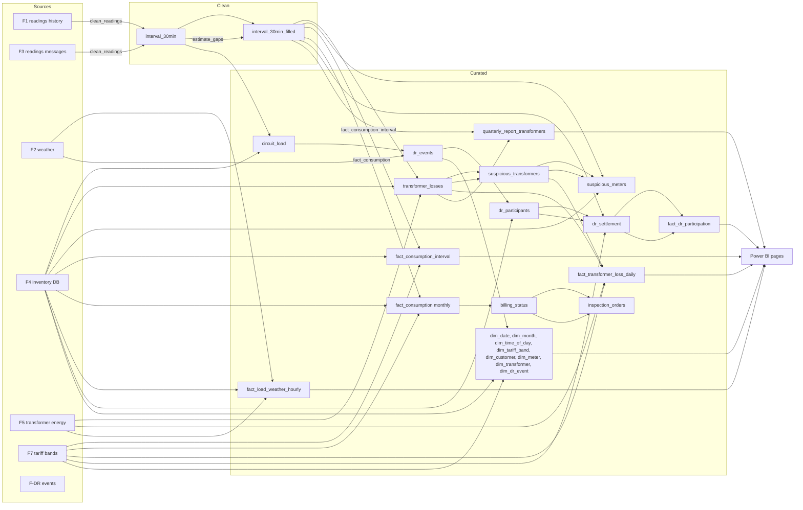

# Lineage of the analytics model (KAN-326)

This page traces where each table of the analytics model comes from: source (F1 to F7), job that writes it, dataset in
the lake, and what reads it. It is the path from a raw file to a Power BI page.

The names of the tables and their columns are in the [analytics dictionary](./analytics-dictionary.md). The model
(facts, dimensions and bus matrix) is in the [dimensional model](./dimensional-model.md). This page only adds the
arrows between them.

## Diagram

## Lineage by table

| Table (lake dataset) | Layer | Written by | Reads | Used by |
|---|---|---|---|---|
| `interval_30min` | clean | `jobs.clean_readings` (US-30) | F1 and F3 readings | `estimate_gaps`, `circuit_load`, `transformer_losses` |
| `interval_30min_filled` | clean | `jobs.estimate_gaps` (US-34, RN-03) | `interval_30min` | all consumption, load and loss jobs |
| `circuit_load` | curated | `jobs.circuit_load` (US-33) | `interval_30min`, F4 meters | RN-08 (events), `dr_events` |
| `transformer_losses` | curated | `jobs.transformer_losses` (US-37, RN-06) | F5, `interval_30min_filled`, F4 meters | `suspicious_transformers`, `fact_transformer_loss_daily`, `quarterly_report_transformers` |
| `suspicious_transformers` | curated | `jobs.transformer_losses` (US-37, RN-06) | `transformer_losses` | `suspicious_meters`, `fact_transformer_loss_daily` |
| `suspicious_meters` | curated | `jobs.suspicious_meters` (US-38, RN-07) | `suspicious_transformers`, `interval_30min_filled`, F4 | inspection (not in Power BI) |
| `fact_consumption_interval` | curated | `jobs.fact_consumption_interval` (US-48) | `interval_30min_filled`, F4 meters, F7 | Power BI consumption (Q1, Q6 pending) |
| `fact_consumption` (monthly) | curated | `jobs.fact_consumption` (US-35) | `interval_30min_filled`, F4 meters, F7 | `billing_status` |
| `billing_status` | curated | `jobs.billing` (US-36, RN-04) | `fact_consumption` | `inspection_orders` |
| `inspection_orders` | curated | `jobs.billing` (US-36, RN-04) | `fact_consumption` | operations |
| `fact_transformer_loss_daily` | curated | `jobs.fact_transformer_loss` (US-51, RN-06) | `transformer_losses`, `suspicious_transformers`, F5, F7 | Power BI losses page (Q2) |
| `fact_load_weather_hourly` | curated | `jobs.fact_load_weather` (US-53, PR data #78) | F5, F2, F4 meters | Power BI load and weather page (Q5, pending) |
| `quarterly_report_transformers` | curated | `jobs.quarterly_report` (US-54) | `fact_transformer_loss_daily`, `interval_30min_filled` | quarterly CSV (KAN-314) |
| `dr_events` | curated | `jobs.dr_events` (US-43, RN-08) | F2, `circuit_load` | `dr_participants`, `dim_dr_event` |
| `dr_participants`, `dr_notifications` | curated | `jobs.dr_events` (US-43) | `dr_events`, F4 meters and contracts | `dr_settlement` |
| `dr_settlement` | curated | `jobs.dr_settlement` (US-44, RN-09) | `dr_participants`, `dr_events`, `interval_30min_filled`, F7 | `fact_dr_participation` |
| `fact_dr_participation` | curated | `jobs.fact_dr_participation` (US-45) | `dr_settlement`, `dr_events`, F4 | Power BI events and incentives page (Q4) |
| `dim_date`, `dim_month`, `dim_time_of_day` | curated | `jobs.dimensions` (US-52) | generated | all facts |
| `dim_tariff_band` | curated | `jobs.dimensions` (US-52) | F7 | `fact_consumption_interval`, `fact_dr_participation` |
| `dim_customer`, `dim_meter`, `dim_transformer` | curated | `jobs.dimensions` (US-52) | F4 | all facts that carry customer, meter or transformer |
| `dim_dr_event` | curated | `jobs.dimensions` (US-52) | `dr_events` | `fact_dr_participation` |

## Sources

| Source | What it is | Enters the lake as |
|---|---|---|
| F1 | Historical readings (2013) | raw readings, read by `clean_readings` |
| F2 | Hourly weather | raw weather, read by `dr_events` and `fact_load_weather` |
| F3 | Readings messages from the concentrators | raw readings, read by `clean_readings` |
| F4 | Inventory database (customers, contracts, meters, transformers, circuits) | PostgreSQL, read with `jobs.inventory` |
| F5 | Energy delivered to each transformer (15-minute rows) | raw F5, read by `transformer_losses` and `fact_load_weather` |
| F7 | Tariff bands and prices | `tariffs.csv`, read by `tariff_bands` |
| DR | Demand-response events | written by the event jobs, read by `dr_events` |

## Differences with the dimensional model

The model and the lake do not match in four places. The lake is the reference for Power BI, so the model should be
updated, not the lake:

1. **Consumption fact.** The model has one `fact_consumption` at meter and 30-minute level. In the lake that is
   `fact_consumption_interval`; `fact_consumption` is the monthly billing aggregate (US-35).
2. **Billing fact.** The model has `fact_billing_monthly`. The lake has `billing_status` (one row per customer and
   month) and `inspection_orders`; there is no fact with that name.
3. **DR participation.** The model lists "events + `fact_consumption`" as the source. The job reads `dr_settlement` and
   `dr_events`.
4. **Exclusion reasons.** `dim_exclusion_reason` is a static list in the model. The lake has no dataset for it: the
   reason is a text column in `inspection_orders`.

## Open points

- `fact_load_weather_hourly` is built from F5 (15-minute rows, summed per hour) and F2 (hourly). If a transformer has an
  incomplete hour, the job leaves it out (`complete hours only`); this has to be stated in Power BI as well.
- The lineage of `dr_events` depends on the weather of F2. If F2 is missing for a day, the events of that day are not
  written. Not checked against a real failure.
- The arrows in the diagram are read from the job docstrings and the dictionary. They were not checked by running the
  jobs against the lake.

## Traceability

KAN-326. Supports the dictionary (KAN-325), the dimensional model (T-10.1, KAN-84) and the Power BI pages (US-53, US-54,
US-61, US-64).
