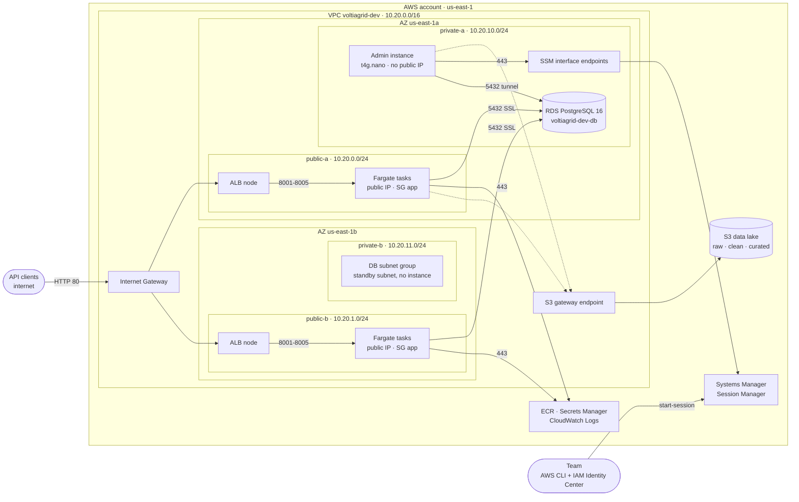

# Physical diagram of the AWS infrastructure (US-26, T-26.1)

> Drawn from the Terraform code in `voltiagrid-api/infra` (stacks `dev` and `data`). Decisions: ADR-011 (region and network),
> ADR-012 (Terraform), ADR-013 (admin instance). Every name below is the real `Name` tag of the resource.



## Subnets and route tables

| Subnet | AZ | CIDR | Route table | Routes | Resources |
|---|---|---|---|---|---|
| `voltiagrid-dev-public-a` | us-east-1a | 10.20.0.0/24 | `voltiagrid-dev-public` | local, `0.0.0.0/0` → IGW, S3 prefix list → S3 endpoint | ALB node, Fargate tasks |
| `voltiagrid-dev-public-b` | us-east-1b | 10.20.1.0/24 | `voltiagrid-dev-public` | same | ALB node, Fargate tasks |
| `voltiagrid-dev-private-a` | us-east-1a | 10.20.10.0/24 | `voltiagrid-dev-private` | local, S3 prefix list → S3 endpoint | RDS, admin instance, SSM endpoints |
| `voltiagrid-dev-private-b` | us-east-1b | 10.20.11.0/24 | `voltiagrid-dev-private` | same | DB subnet group (second AZ) |

There is **no NAT Gateway** and the private route table has **no route to the internet** (ADR-011).

## Security Groups: who can talk to whom

| From \ To | alb | app | rds | endpoints |
|---|---|---|---|---|
| Internet | **80** | — | — | — |
| alb | — | **8001, 8002, 8003, 8005** | — | — |
| app | (80 to the ALB public address) | — | **5432** | — |
| admin | — | — | **5432** | **443** |

- `admin` accepts nothing inbound. `rds`, `app` and `endpoints` accept traffic only from other Security Groups, never from an IP range.
- Egress is also explicit: `app` may go out on 443 (AWS APIs), 80 (the ALB) and 5432 (RDS); `admin` on 443 to the endpoints and S3, and 5432 to RDS.
- The default Security Group of the VPC has no rules.

## Traffic flows

| # | Flow | Path |
|---|---|---|
| 1 | Client calls an API | Internet → IGW → ALB (80) → rule by path prefix → target group → Fargate task (8001–8005) |
| 2 | API reads the inventory | Fargate task → RDS (5432, SSL), private address in the same VPC |
| 3 | Task starts | ECS pulls the image from ECR and reads the secrets from Secrets Manager (443 through the IGW, public IP of the task) |
| 4 | Logs | Container stdout → awslogs driver → CloudWatch Logs |
| 5 | Control center asks F5 | Fargate task → ALB `/f5` → F5 task |
| 6 | Admin opens a session | Laptop → Session Manager → SSM interface endpoints → admin instance; port forwarding → RDS |
| 7 | Anything to S3 | Route to the S3 prefix list → gateway endpoint → S3 (never the internet) |

## How to check it against what is deployed

The review of US-26 (T-26.3) compares this page with the live account:

```powershell
aws ec2 describe-subnets --filters "Name=tag:Project,Values=voltiagrid" --query "Subnets[].{name:Tags[?Key=='Name']|[0].Value,az:AvailabilityZone,cidr:CidrBlock}" --output table
aws ec2 describe-vpc-endpoints --filters "Name=tag:Project,Values=voltiagrid" --query "VpcEndpoints[].{service:ServiceName,type:VpcEndpointType}" --output table
aws rds describe-db-instances --query "DBInstances[].{db:DBInstanceIdentifier,az:AvailabilityZone,public:PubliclyAccessible}" --output table
aws elbv2 describe-load-balancers --query "LoadBalancers[].{name:LoadBalancerName,scheme:Scheme,azs:AvailabilityZones[].ZoneName}" --output json
```
